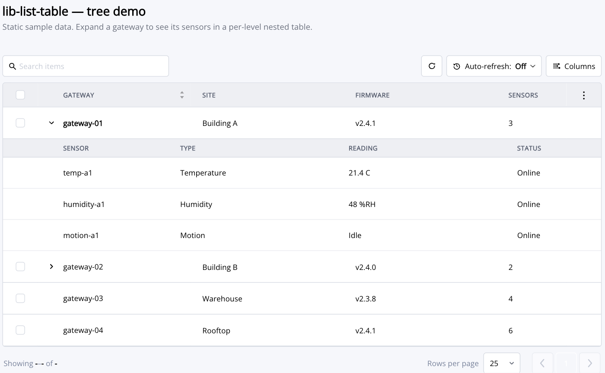

# lib-list-table

A themeable, declarative table for the Ziti console. You describe the table with a
`ListColumn[]` and a row array; the component handles sorting, column show/hide/reorder/resize,
filtering, pagination, selection, row actions, and - in tree mode - expandable nested rows with
their own per-depth columns.

It replaces the legacy ag-grid `lib-data-table`. Styling is driven entirely by `--lt-*` CSS tokens
(see `shared-assets/styles/global.scss`) scoped under `.lt-skin`, so a host can reskin it without
touching the component.



## Setup

The component is declared in `OpenZitiConsoleLibModule` (it is not standalone). Import that module
in your feature module and use the `lib-list-table` selector.

```ts
import { ListColumn } from '@openziti/ziti-console-lib';
```

## Basic (flat) table

```ts
columns: ListColumn[] = [
  { key: 'name',      label: 'Name', sortable: true },
  { key: 'type',      label: 'Type' },
  { key: 'createdAt', label: 'Created',
    valueFormatter: (shim) => new Date(shim.value).toLocaleString() },
];

rowData: any[] = [
  { name: 'alpha', type: 'Service', createdAt: '2026-10-01T12:00:00Z' },
  { name: 'beta',  type: 'Router',  createdAt: '2026-10-02T09:30:00Z' },
];
```

```html
<lib-list-table
  tableId="my-things"
  [columns]="columns"
  [rowData]="rowData"
  [isLoading]="isLoading"
  (actionRequested)="onAction($event)">
</lib-list-table>
```

`tableId` is required - it namespaces the per-table state the component persists to `localStorage`
(column order/visibility/width, page size, and tree-view choices).

## Rendering a cell

Precedence for a cell is `cell` > `cellHtml` > `valueFormatter` > the raw value at `field`.

- **Component cell (preferred).** Render an Angular component and map the row to its inputs:

  ```ts
  { key: 'roles', label: 'Roles',
    cell: AttributeCellComponent,
    cellInputs: (ctx) => ({ attributes: ctx.row.roleAttributes, field: ctx.colId }) }
  ```

- **`valueFormatter`** returns plain text. Use for simple formatting.
- **`cellHtml`** returns sanitized markup (kept for legacy string renderers). Prefer a component
  cell for anything that interpolates entity data - it escapes for you.

Row actions flow out through `cellInputs`'s `ctx.emitAction(action, item)` (or the row `...` menu) to
the table's `(actionRequested)` output, where the page handles them.

## Tree / nested tables

Turn on tree mode with `[options]="{ tree: true }"`. A row is expandable when it is not a leaf and
either carries children or a `loadChildren` loader is provided.

**Row shape**

- `row.children: any[]` - eager children, rendered on expand.
- `row.leaf: true` - the row shows no expand control.
- Neither, plus a `loadChildren` input - children are fetched lazily the first time the row expands.

```ts
options = { tree: true };

// eager children
rowData = [
  { name: 'Group A', children: [
    { dest: '10.0.0.1', port: 443, leaf: true },
    { dest: '10.0.0.2', port: 80,  leaf: true },
  ]},
];

// lazy children (returns the child rows; array or Promise)
loadChildren = (row: any) => this.api.childrenFor(row.id);
```

**Per-depth columns.** Children need not share the parent's columns. `childColumnsByLevel` is indexed
by depth (level 0 uses `columns`); a level renders in its own grid with a per-level sub-header:

```ts
childColumnsByLevel: ListColumn[][] = [
  [],                                          // level 0 -> uses `columns`
  [ { key: 'dest', label: 'Destination', treeColumn: true },
    { key: 'port', label: 'Port' } ],          // level 1 columns
];
```

- `treeColumn: true` marks the column that carries the expand control and indentation. If no column
  sets it, the first visible (non-structural) column is used.
- Users can show/hide/reorder/resize each level's columns from the **Columns** menu; the choice is
  persisted per table.

**Layout variant.** `treeVariant` is `'card'` (each nested level floats as a bordered card, the
default) or `'flat'` (nested rows sit inline with the table, the first column tucking under the
parent row's name). `showTreeVariantToggle` surfaces a switch in the Columns menu; otherwise the host
owns the variant through the input.

```html
<lib-list-table
  tableId="traffic"
  [columns]="columns"
  [rowData]="rowData"
  [options]="{ tree: true }"
  [childColumnsByLevel]="childColumnsByLevel"
  [loadChildren]="loadChildren"
  treeVariant="flat"
  (nodeToggled)="onToggle($event)">
</lib-list-table>
```

> Tree runtime state (`children`, `leaf`, and internal `__tree*` fields) is written onto the row
> objects. A host that reuses a row object in a save/update call should strip those first.

## Inputs

| Input | Type | Purpose |
|---|---|---|
| `tableId` | `string` | **Required.** Namespaces persisted state. |
| `columns` | `ListColumn[]` | Level-0 column definitions. |
| `rowData` | `any[]` | Rows to render (tree roots in tree mode). |
| `isLoading` | `boolean` | Shows the loading state. |
| `options` | `{ noSelect?, noMenu?, pager?, tree?, fitColumns? }` | Structural options. `tree` enables nested rows; `fitColumns` trades width between a column and a sink on resize. |
| `loadChildren` | `(row) => any[] \| Promise<any[]>` | Lazy child loader (tree mode). |
| `childColumnsByLevel` | `ListColumn[][]` | Columns per depth (index = level). |
| `treeVariant` | `'card' \| 'flat'` | Nested-row layout. |
| `showTreeVariantToggle` | `boolean` | Show the card/flat switch in the Columns menu. |
| `menuItems` / `headerActions` | `any[]` | Row `...` menu items and header actions. |
| `startCount` / `endCount` / `totalCount` / `hasNext` / `hasPrev` | - | Pager display. |
| `initialPageSize` | `number` | Default page size (persisted after first change). |
| `filterApplied`, `noItemsImage`, `accessDenied`, ... | - | Empty/filtered/denied states. |

## Outputs

| Output | Payload | Fires when |
|---|---|---|
| `actionRequested` | `{ action, item? }` | A row action, header action, selection toggle, or pager action occurs. |
| `nodeToggled` | `{ row, expanded }` | A tree row is expanded or collapsed. |
| `tableReady` | the table instance | After the table initializes. |

## ListColumn reference (common fields)

| Field | Purpose |
|---|---|
| `key` | Stable column id; used for persistence and tracking. |
| `field` | Dot-path to the row value. Defaults to `key`. |
| `label` | Header text. |
| `cell` / `cellInputs` | Component cell and its input mapper. |
| `cellHtml` / `valueFormatter` | Sanitized-markup or plain-text renderers. |
| `width` / `minWidth` / `resizable` | Sizing. Omit `width` to flex. |
| `sortable` / `onSort` | Enable the header sort and react to it. |
| `filterType` / `filterField` / `headerParams` | Header-filter plumbing. |
| `hideable` / `hidden` / `excludeFromChooser` / `reorderable` | Column-chrome behavior. |
| `treeColumn` | Tree mode: the column that holds the expand control and indentation. |

See `list-column.ts` for the full interface.
